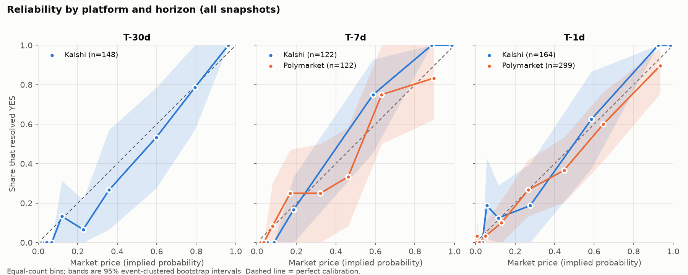
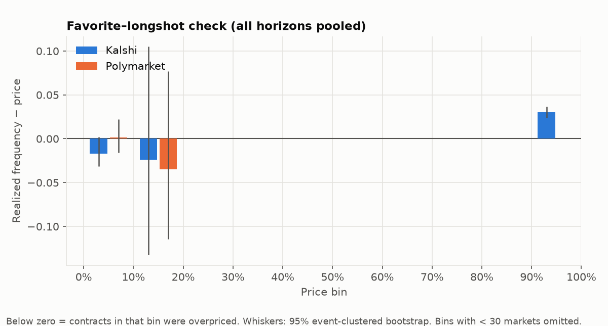
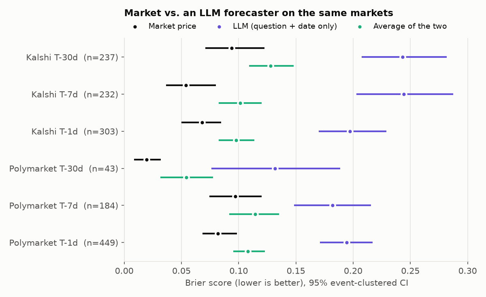

# Are prediction markets calibrated?

When Kalshi or Polymarket prices an event at 70%, does it happen about 70% of the time? I checked
resolved binary markets from both platforms, priced at fixed horizons before their scheduled close,
with standard forecast-evaluation tools and uncertainty that accounts for correlated markets.

## Answer

**Mostly yes, with a measurable longshot bias.** Across 5,241 resolved markets (2,419 events,
Nov 2024 – Nov 2026), events priced at *p* happened close to *p* of the time on both platforms,
at every horizon.

| | T-30d | T-7d | T-1d |
|---|---|---|---|
| **Kalshi**: skill (BSS) | +0.56 [0.49, 0.62] | +0.71 [0.63, 0.77] | +0.67 [0.61, 0.72] |
| **Kalshi**: calibration error (ECE) | 0.025 | 0.038 | 0.028 |
| **Polymarket**: skill (BSS) | +0.70 [0.57, 0.80]* | +0.51 [0.44, 0.57] | +0.58 [0.53, 0.62] |
| **Polymarket**: calibration error (ECE) | 0.077* | 0.022 | 0.024 |
| Markets (Kalshi / Polymarket) | 776 / 153 | 763 / 690 | 1,010 / 1,555 |

BSS = Brier skill score against always forecasting the base rate (0 = no skill, 1 = perfect).
Brackets are 95% intervals that resample whole events. \*Only 91 Polymarket events last a month, so
treat that column as indicative.



**What the data supports**

- **Prices behave like probabilities.** Miscalibration (the Murphy reliability term, ≤0.003) is a
  small slice of the Brier score; almost all of the score is irreducible uncertainty minus
  resolution. Results hold with one market per event and on the fixed population.
- **Markets get sharper, not more calibrated, as resolution nears.** On Kalshi markets priced at all
  three horizons, skill climbs from +0.39 at T-30d to +0.72 at T-7d and +0.84 at T-1d while
  calibration error stays around 0.03–0.05.
- **Thin markets are less informative, not less honest.** Kalshi T-1d skill rises from +0.50
  (<1k contracts traded before the snapshot) to +0.90 (≥100k), with calibration error flat at
  0.02–0.04.
- **A favorite–longshot bias exists but is small.** Kalshi contracts under 10¢ resolved YES 2.3
  points less often than priced [−2.9, −1.6]; Polymarket's 10–40¢ bins ran 4–9 points rich.
  Favorites were within ±1.5 points. After fees and spreads, a few cents of overpricing on cheap
  contracts isn't obviously exploitable.



**Markets vs. an LLM.** An open-weights model (gpt-oss-20b, knowledge cutoff June 2024, so it can't
remember any of these outcomes) forecast 1,000 random markets from the question and close date alone.
The market's Brier score beat it in every platform × horizon cell, by 0.09–0.19, all intervals
excluding zero. Averaging the two was *worse* than the market alone. The LLM was also badly
calibrated (ECE 0.10–0.22) and sometimes incoherent: it rated "2-year yield below 4.59%" more likely
than "below 4.64%".



**What it can't settle.** Calibration is necessary for "markets produce probabilities," not
sufficient. Whether these prices inform decisions anyone actually makes, and whether the platforms
are gambling under a futures-market license, are questions about use and regulation that this data
doesn't reach. See the [write-up](docs/blog_post.md) for how this bears on Recht's argument.

Explore the results interactively with `make app`, or read [`reports/scorecard.json`](reports/scorecard.json)
for every number with its interval.


## Why this question

Ben Recht recently argued that prediction markets ["don't produce probabilities in any reasonable
sense"](https://www.argmin.net/p/no-one-buys-corn-in-the-corn-market). Much of that argument is about
incentives and regulation, which data can't settle. One part can be checked: if prices behave like
probabilities, priced-at-p events should happen about p of the time, across platforms, categories,
liquidity levels and horizons. That's necessary for "markets produce probabilities," not sufficient:
a calibrated market can still be useless for decisions if it only becomes sharp the day before.

## Method

| Step | What happens |
|---|---|
| Sample | Resolved binary markets whose *scheduled* close falls between 2024-11-01 and 2026-11-01. Kalshi is sampled through its `/series` catalog, Polymarket through randomly drawn days of closed events. Both are stratified by a shared 8-category scheme, with at most 3 markets per event so threshold ladders can't dominate. Selection never looks at volume. |
| Snapshot | Price at **T-30d, T-7d and T-1d before the scheduled close**. Kalshi: bid/ask midpoint when the book is ≤10¢ wide, otherwise last trade. Polymarket: its displayed price (it publishes no historical quotes), gated on a real trade in the prior 48h. |
| Score | Brier score, log loss (clipped to [1e-4, 1−1e-4]), reliability curves with 10 equal-count bins, ECE, the Murphy decomposition (with the Stephenson within-bin terms so it sums exactly), and Brier skill score against the group's base rate. |
| Uncertainty | 95% percentile bootstrap that resamples **events**, not markets. Ten candidates in one election aren't ten independent forecasts. |
| Robustness | Same metrics on (a) the fixed population of markets priced at all three horizons, and (b) one randomly chosen market per event. Breakdowns by category, by pre-snapshot volume, and by price type. |

Details of each API (and where it disagreed with its docs) are in
[docs/data_sources.md](docs/data_sources.md).

## Leakage safeguards

Look-ahead bias is the easiest way to make markets look better than they are, so each rule below is
enforced in code and covered by a test.

- **Horizons anchor to the scheduled close, never resolution.** "By Dec 31" markets resolve YES early
  and NO at the deadline, so "resolution − 1 day" depends on the outcome. The snapshot code never
  receives the resolution timestamp, and a property test checks that changing it changes nothing.
- **Only data at or before the snapshot is visible**, volume included: liquidity buckets use contracts
  traded *before* the snapshot, never final volume. A Hypothesis test appends arbitrary future rows
  (with absurd volume) and checks that no snapshot changes.
- **Polymarket's 3-hour price buckets are timestamped at their end**, because a bucket labeled 12:00
  can include trades up to 15:00.
- **Stale prices are dropped and counted, never forward-filled**: no trade or quote in the 48h before
  the snapshot means no snapshot.
- **Capped volume stays unknown.** When Polymarket's trade history is too long to page fully, the
  market gets an explicit `unknown` liquidity bucket unless the partial count already proves it's in
  the top bucket.
- **A test runs over the real snapshot table** and checks every row for `price_ts ≤ snapshot_ts` and a
  recomputed `volume_before`.

## Limitations

- **Prices aren't free probabilities.** Fees and the bid/ask spread mean a 3¢ contract can be
  "overpriced" without being exploitable. Calibration here measures the price, not a trading edge.
- **Correlated markets.** Clustering by event handles markets inside one event; it doesn't handle
  correlation *across* events (every Fed-adjacent market moving on one CPI print).
- **Sample selection.** Stratifying by category means pooled results describe that mix, not the
  platforms' actual volume-weighted activity. Short-dated recurring brackets are reported as their
  own category because they'd otherwise swamp the pool.
- **Platform asymmetry.** Kalshi snapshots can use quotes; Polymarket's can't (no historical book).
  Results by price type are in the scorecard.
- **A conservative anchor costs some Kalshi markets.** Kalshi's scheduled expiration sometimes
  includes a data-release buffer, so some markets close before their T-1d snapshot and drop out.
  The alternative timestamp appears to be updated after the event, which would leak the outcome.
- **The LLM sees only the title.** Some Kalshi titles are terse ("Apple AI partnership?"), which
  handicaps the LLM on purpose: the comparison is market price vs. a model with no news.
- **Resolution is taken as given.** Markets that resolved ambiguously (50/50) or were voided are
  excluded and counted, not adjudicated.

## Reproduce

```bash
uv sync --all-extras
make data        # ingest both platforms (cached, resumable) + data-quality report
make snapshots   # leak-free snapshots
make eval        # reports/scorecard.json and reports/figures/
make test        # parsers, leakage properties, metric properties
make app         # Streamlit explorer at localhost:8501
make llm         # optional: LLM baseline against a local vLLM server
```

The raw API cache (`data/`) isn't committed. `make data` rebuilds it, and every response is cached, so
a rerun makes no new requests. The dashboard reads only `app/data/snapshots.parquet`, so it also
runs from a fresh clone (`docker build -t calib . && docker run -p 8501:8501 calib`).

## Layout

```
src/calib/
  ingest_kalshi.py, ingest_polymarket.py   # fetch + pure parsers -> DuckDB
  snapshots.py                             # leak-free snapshot rules
  metrics.py                               # arrays in, numbers out
  report.py                                # scorecard + figures
  llm_forecast.py                          # optional LLM baseline
app/app.py                                 # dashboard
tests/                                     # fixtures, leakage + metric property tests
```

## Status

- [x] API survey
- [x] Data pipeline
- [x] Leak-free snapshots and leakage tests
- [x] Metrics and scorecard
- [x] Dashboard
- [x] Results (5,241 markets) and LLM baseline (1,000 markets)
- [ ] Blog post (draft in progress)
